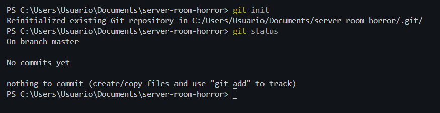
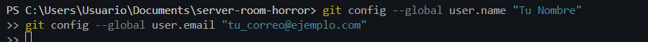
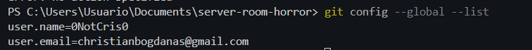
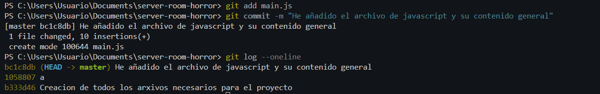
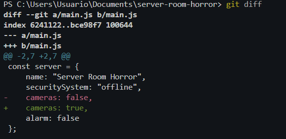
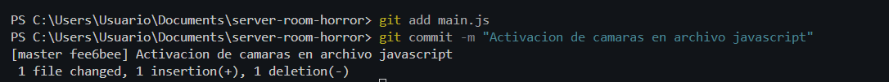
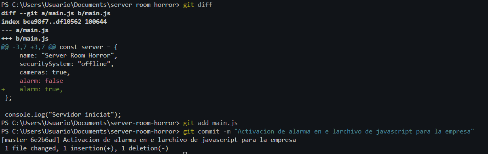
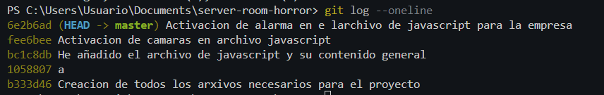

# Bloc 1: Invocació del Repositori i Línia Base

## Introducció

En aquest primer bloc s'ha creat i configurat el repositori local del projecte `server-room-horror`.

L'objectiu és establir una línia base estable del sistema, configurar la identitat de l'autor i registrar els primers canvis mitjançant commits.

---

## Acció 3.1: Creació i inicialització del repositori

### Explicació tècnica

Primerament, s'ha creat un directori anomenat `server-room-horror` per emmagatzemar els fitxers del projecte.

Posteriorment, s'ha inicialitzat un repositori Git local mitjançant la comanda `git init`.

Aquesta operació crea l'estructura interna necessària per gestionar el control de versions i estableix `main` com a branca principal.

Finalment, s'ha comprovat l'estat inicial del repositori amb `git status`.

### Comandaments executats

```bash
mkdir server-room-horror
cd server-room-horror
git init -b main
git status
```





---

## Acció 3.2: Configuració de la identitat de Git

### Explicació tècnica

S'ha configurat el nom i el correu electrònic de l'autor dels commits.

Aquesta configuració permet identificar qui ha realitzat cada modificació i garanteix la traçabilitat de l'historial del projecte.


Finalment, s'ha verificat la configuració aplicada.

### Comandaments executats

```bash
git config --global user.name "El Teu Nom"
git config --global user.email "correu@exemple.com"
git config --global --list
```

Aqui no he posat el meu nom ni el mue correu, perque ja el tinc configurat.





---

## Acció 3.3: Creació de l'aplicació i primer commit

### Explicació tècnica

S'ha creat el fitxer principal `main.js`, que conté l'estructura inicial del sistema de seguretat de l'edifici.

L'aplicació està desenvolupada en JavaScript i defineix un objecte que representa el servidor i diferents propietats de seguretat.

Inicialment, el sistema de seguretat, les càmeres i les alarmes es troben desactivats.

Un cop creat el fitxer, s'ha afegit a l'àrea de preparació de Git amb `git add` i s'ha registrat el primer commit.

### Codi inicial de main.js

```javascript
const server = {
    name: "Server Room Horror",
    securitySystem: "offline",
    cameras: false,
    alarm: false
};

console.log("Servidor iniciat");
console.log(server);
```

### Comandaments executats

```bash
git add main.js
git commit -m "missatge"
git log --oneline
```




---

## Acció 3.4: Implementació del sistema de seguretat

### Primera modificació: Activació de les càmeres

#### Explicació tècnica

S'ha realitzat una primera modificació al fitxer `main.js` per activar les càmeres de vigilància de l'edifici.

La propietat `cameras` ha passat de `false` a `true`.

Abans de registrar el canvi, s'ha utilitzat `git diff` per comprovar les diferències respecte a la versió anterior.

Posteriorment, s'ha creat el segon commit de l'historial.

#### Modificació realitzada

```javascript
cameras: true,
```

#### Comandaments executats

```bash
git diff
git add main.js
git commit -m "missatge"
```





### Segona modificació: Activació de l'alarma

#### Explicació tècnica

A continuació, s'ha implementat una segona millora del sistema de seguretat.

S'ha modificat la propietat `alarm`, establint el valor `true` per activar el sistema d'alarma de l'edifici.

Aquesta modificació s'ha registrat en un tercer commit independent per mantenir un historial clar i ordenat dels canvis.

#### Modificació realitzada

```javascript
alarm: true
```

#### Comandaments executats

```bash
git diff
git add main.js
git commit -m "missatge"
```




---

## Acció 3.5: Comprovació de l'historial inicial

### Explicació tècnica

Després de completar les modificacions inicials, s'ha consultat l'historial de Git per verificar que els tres commits s'han registrat correctament.

La comanda `git log --oneline` permet visualitzar una versió simplificada de l'historial, mostrant l'identificador abreujat i el missatge de cada commit en una sola línia.

Aquesta comprovació confirma que existeix una línia temporal inicial estable que servirà com a base per crear les branques del següent bloc.

### Comandament executat

```bash
git log --oneline
```




---

## Conclusió del Bloc 1

En aquest primer bloc s'ha inicialitzat correctament el repositori Git i s'ha configurat la identitat de l'autor.

També s'ha desenvolupat l'estructura inicial de l'aplicació JavaScript i s'han registrat tres commits que representen l'evolució del sistema de seguretat.

El repositori disposa ara d'una base estable per començar a treballar amb branques i fusions.