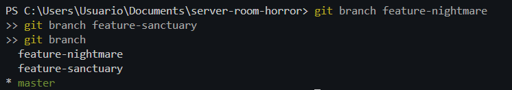
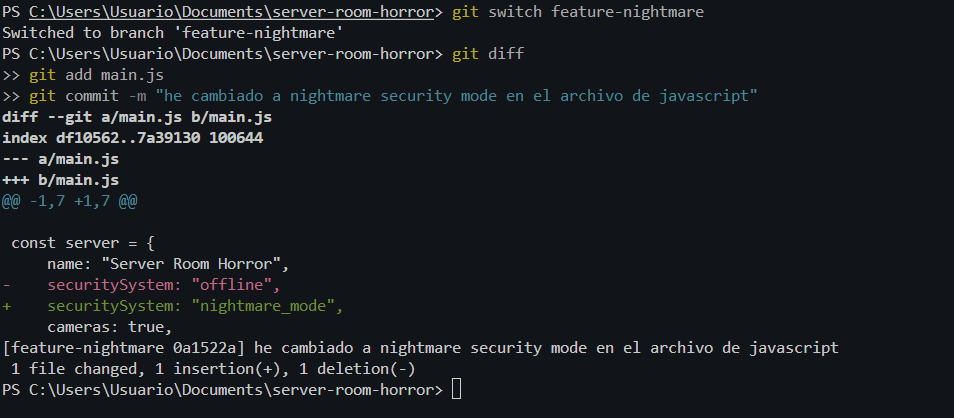
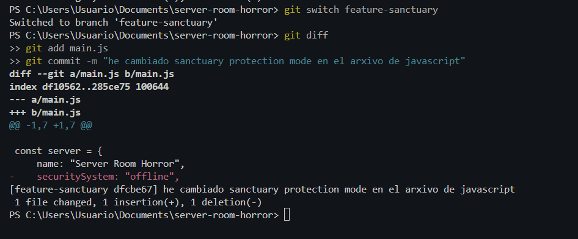
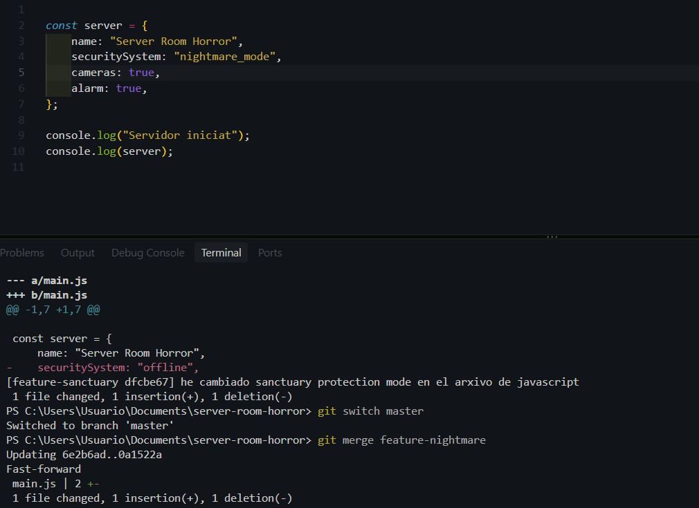
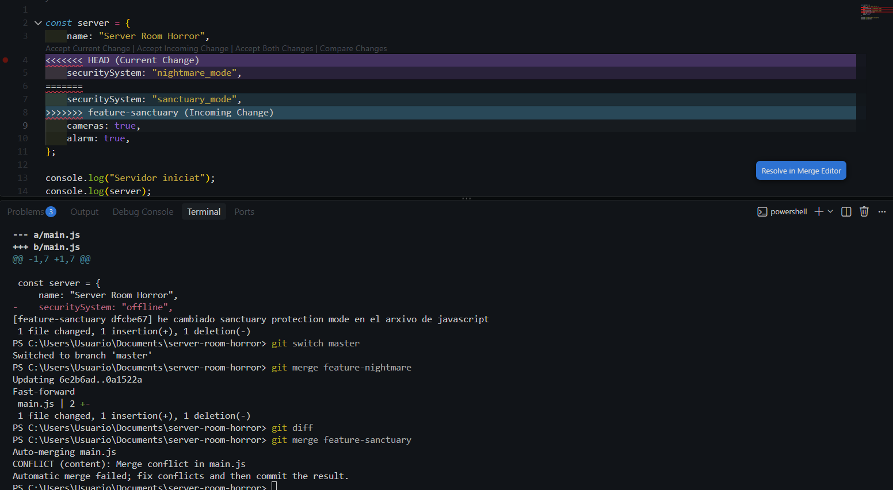
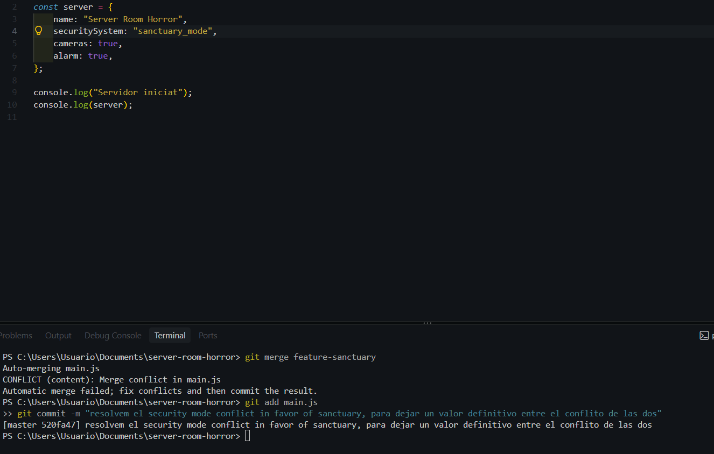
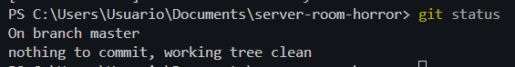

# Bloc 2: Les Branques del Més Enllà i Resolució del Conflicte

## Introducció

En aquest segon bloc s'ha treballat amb branques de Git per desenvolupar dues versions alternatives del sistema de seguretat.

La primera branca representa una dimensió fosca que intenta comprometre el servidor, mentre que la segona representa una línia temporal de protecció.

L'objectiu principal és crear les dues branques, modificar el mateix fragment de codi, provocar un conflicte de fusió i resoldre'l manualment per preservar la seguretat del sistema.

---

## Acció 3.6: Creació de les branques alternatives

### Explicació tècnica

S'han creat dues branques de desenvolupament a partir de la branca principal `main`:

- `feature-nightmare`: representa la dimensió fosca.
- `feature-sanctuary`: representa la línia temporal de protecció.

Les dues branques s'han creat a partir del mateix commit de la línia principal, després d'haver implementat les càmeres i el sistema d'alarma.

Aquesta decisió permet treballar en dues versions independents del mateix codi i generar un conflicte quan s'intenten integrar les modificacions.

### Justificació de la topologia

S'ha escollit una topologia de branques paral·leles perquè les dues funcionalitats parteixen d'una base comuna.

D'aquesta manera, cada branca pot evolucionar independentment sense modificar directament la branca principal.

A més, aquesta estructura permet demostrar el funcionament de les fusions de Git, la detecció de modificacions incompatibles i la resolució manual dels conflictes.

### Comandaments executats

```bash
git switch main
git branch feature-nightmare
git branch feature-sanctuary
git branch
```



---

## Acció 3.7: Desenvolupament de la branca feature-nightmare

### Explicació tècnica

S'ha accedit a la branca `feature-nightmare` mitjançant la comanda `git switch`.

Dins d'aquesta branca s'ha modificat el fitxer `main.js`, canviant el valor de la propietat `securitySystem`.

El valor original `offline` s'ha substituït per `nightmare_mode`, que representa l'activació del sistema de seguretat corromput.

Aquesta modificació s'ha registrat en un commit propi per mantenir els canvis aïllats de la branca principal.

### Modificació realitzada

```javascript
securitySystem: "nightmare_mode",
```

### Comandaments executats

```bash
git switch feature-nightmare
git diff
git add main.js
git commit -m "missatge"
```



---

## Acció 3.8: Desenvolupament de la branca feature-sanctuary

### Explicació tècnica

Posteriorment, s'ha canviat a la branca `feature-sanctuary` per desenvolupar la versió protectora del sistema.

S'ha modificat exactament la mateixa línia del fitxer `main.js` que s'havia alterat a la branca anterior.

En aquest cas, el valor de `securitySystem` s'ha establert com a `sanctuary_mode`, que representa un sistema de protecció segur.

Aquesta modificació també s'ha enregistrat en un commit independent.

El fet de modificar la mateixa línia amb valors diferents provocarà un conflicte quan es fusionin les dues branques.

### Modificació realitzada

```javascript
securitySystem: "sanctuary_mode",
```

### Comandaments executats

```bash
git switch feature-sanctuary
git diff
git add main.js
git commit -m "missatge"
```




---

## Acció 3.9: Integració de les branques a main

### Explicació tècnica

Un cop finalitzat el desenvolupament de les dues branques, s'ha tornat a la branca principal `main`.

Primerament, s'ha integrat la branca `feature-nightmare` mitjançant `git merge `.

La primera fusió s'ha completat correctament.

### Comandaments de la primera fusió

```bash
git switch main
git merge feature-nightmare
git log --oneline --graph --all
```




### Intent de fusió de la segona branca

A continuació, s'ha intentat integrar `feature-sanctuary` a la branca principal.

Com que les dues branques havien modificat la mateixa línia de `main.js` amb valors diferents, Git no ha pogut decidir automàticament quin canvi conservar.

Per aquest motiu, s'ha produït un conflicte de fusió.

### Comandaments executats

```bash
git merge feature-sanctuary
```


---

## Acció 3.10: Resolució manual del conflicte

### Explicació tècnica

Després de detectar el conflicte de fusió, s'ha inspeccionat el fitxer `main.js` per identificar les modificacions incompatibles.

Git ha inserit automàticament les marques de conflicte següents:

- `<<<<<<< HEAD`: indica la versió de la branca actual.
- `=======`: separa les dues versions en conflicte.
- `>>>>>>> feature-sanctuary`: indica la versió de la branca que s'està integrant.

### Fragment del conflicte

```text
<<<<<<< HEAD
    securitySystem: "nightmare_mode",
=======
    securitySystem: "sanctuary_mode",
>>>>>>> feature-sanctuary
```




### Solució aplicada

Per garantir la seguretat del servidor, s'ha decidit conservar la versió protectora `sanctuary_mode`.

S'han eliminat manualment totes les marques de conflicte i s'ha deixat una única definició de la propietat `securitySystem`.

Aquesta decisió evita mantenir el mode maliciós i permet conservar el funcionament de les càmeres i l'alarma.

### Codi definitiu

```javascript
const server = {
    name: "Server Room Horror",
    securitySystem: "sanctuary_mode",
    cameras: true,
    alarm: true
};

console.log("Servidor iniciat");
console.log(server);
```

### Finalització de la fusió

Un cop corregit el fitxer, s'ha afegit a l'àrea de preparació i s'ha creat el commit de fusió corresponent.

Finalment, s'ha comprovat que el repositori no tenia modificacions pendents.

### Comandaments executats

```bash
git add main.js
git commit -m "missatge"
git status
```






---

## Conclusió del Bloc 2

En aquest bloc s'han creat dues branques de desenvolupament paral·leles i s'han implementat modificacions incompatibles sobre el mateix fitxer.

La integració de les branques ha provocat un conflicte de fusió que s'ha resolt manualment, seleccionant la versió protectora del sistema.

Finalment, la branca principal ha quedat integrada correctament amb el mode `sanctuary_mode` i sense marques de conflicte al codi.

Aquest procés ha permès comprendre el funcionament de les branques, els commits de fusió i la resolució de conflictes amb Git.