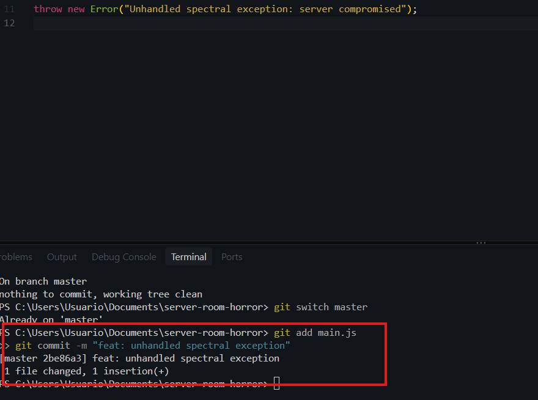
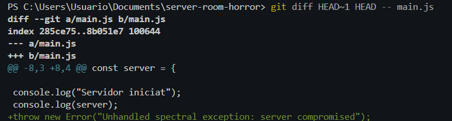
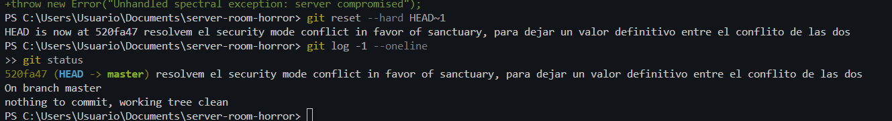
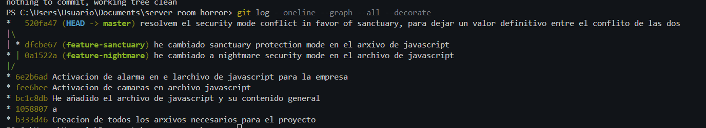

# Bloc 3: Viatge Temporal, Exorcisme del Codi i Publicació Remota

## Introducció

En aquest tercer bloc es simula una nova infecció del repositori mitjançant un commit que introdueix un error a l'aplicació.

L'objectiu és identificar les modificacions defectuoses, comparar-les amb l'última versió segura i restaurar el repositori utilitzant les eines de recuperació de Git.

Finalment, es comprova la topologia de l'historial i es publica el projecte a GitHub per permetre'n l'auditoria.

---

## Acció 3.11: Introducció del commit infectat

### Explicació tècnica

Després de resoldre el conflicte entre les dues branques, s'ha introduït intencionadament una modificació defectuosa a `main.js`.

Aquesta modificació consisteix en una instrucció `throw new Error()`, que provoca una excepció no controlada durant l'execució de l'aplicació.

L'objectiu és simular una infecció del sistema i generar un estat incorrecte que posteriorment haurà de ser eliminat.

Aquesta modificació s'ha registrat amb el missatge indicat a l'enunciat.

### Codi maliciós introduït

```javascript
throw new Error("Unhandled spectral exception: server compromised");
```

### Comandaments executats

```bash
git switch main
git status
git add main.js
git commit -m "missatge"
```


L'execució genera un error intencionat que demostra que el codi introduït afecta el funcionament correcte del servidor.





---

## Acció 3.12: Anàlisi de les diferències amb l'última versió segura

### Explicació tècnica

Un cop introduït el commit defectuós, s'ha utilitzat la comanda `git diff` per comparar el codi infectat amb l'estat anterior del repositori.

La referència `HEAD` identifica el commit actual, mentre que `HEAD~1` fa referència al commit immediatament anterior.

D'aquesta manera, es poden visualitzar les modificacions exactes introduïdes per la infecció.

L'anàlisi permet identificar la instrucció que provoca l'excepció i determinar quin canvi cal eliminar.

### Comandament executat

```bash
git diff HEAD~1 HEAD -- main.js
```

### Anàlisi del resultat

La comparació mostra que el commit infectat ha incorporat una instrucció que força una excepció durant l'execució.

Aquesta modificació no forma part del funcionament previst de l'aplicació i compromet l'estabilitat del sistema.

Per aquest motiu, es decideix restaurar l'estat anterior del repositori.




---

## Acció 3.13: Restauració de l'últim estat segur

### Explicació tècnica

Per eliminar el commit infectat, s'ha executat la comanda `git reset --hard HEAD~1`.

Aquesta instrucció mou la referència de la branca actual al commit anterior i restaura els fitxers seguits per Git perquè coincideixin amb aquell estat.

A diferència de `git revert`, que crea un nou commit per desfer els canvis, `git reset --hard` reescriu la posició de la branca, de manera que el commit infectat deixa de formar part de l'historial visible de `main`.

Aquesta operació també descarta els canvis no confirmats dels fitxers seguits per Git.

En aquest cas, s'ha utilitzat perquè l'enunciat exigeix eliminar el commit defectuós de la línia temporal principal i recuperar l'estat segur anterior.

### Comandaments executats

```bash
git reset --hard HEAD~1
git log -1 --oneline
git status
cat main.js
```

### Resultat de la restauració

Després d'executar la comanda, el fitxer `main.js` torna a contenir el sistema de seguretat amb el mode `sanctuary_mode`.

La instrucció maliciosa desapareix del codi i el commit infectat deixa d'aparèixer a l'historial normal de la branca principal.

Cal destacar que Git pot conservar temporalment referències recuperables mitjançant el registre intern `reflog`, però la branca principal ja no apunta al commit defectuós.



---

## Acció 3.14: Visualització de la topologia final del repositori

### Explicació tècnica

Després de restaurar el repositori, s'ha consultat l'historial de Git en format gràfic.

La comanda `git log --oneline --graph --all --decorate` permet visualitzar les bifurcacions, els commits i les fusions del projecte.

Aquesta representació facilita la comprovació de l'evolució de les dues branques alternatives i permet verificar que s'han conservat els commits de fusió.

També permet comprovar que el commit infectat no forma part de la línia temporal principal.

### Comandament executat

```bash
git log --oneline --graph --all --decorate
```

### Anàlisi de l'historial

A l'arbre de Git es poden identificar els elements següents:

- Els tres commits inicials del projecte.
- La bifurcació de les branques `feature-nightmare` i `feature-sanctuary`.
- El commit de desenvolupament de cadascuna de les dues branques.
- El primer commit de fusió de `feature-nightmare`.
- El commit de fusió que resol el conflicte amb `feature-sanctuary`.
- La restauració de la branca principal a un estat segur.

La topologia confirma que les dues línies de desenvolupament han estat integrades i que el codi defectuós s'ha eliminat de la branca principal.



---

## Acció 3.15: Creació i publicació del repositori a GitHub

### Explicació tècnica

Un cop restaurat el sistema, s'ha creat un repositori públic a GitHub anomenat `halloween-git-rescue`.

L'objectiu d'aquesta publicació és permetre l'auditoria externa del projecte i proporcionar accés als fitxers, les branques, els commits i la documentació de la pràctica.

Primerament, s'ha creat el repositori remot des de la interfície web de GitHub.

Posteriorment, s'ha establert la connexió entre el repositori local i el remot mitjançant `git remote add origin`.

Finalment, s'han publicat la branca principal i les dues branques de desenvolupament.

### Configuració del repositori remot

```bash
git remote add origin https://github.com/0NotCris0/halloween-git-rescue.git
git remote -v
```

### Publicació de la branca principal

```bash
git push -u origin master
```

### Publicació de les branques alternatives

```bash
git push origin feature-nightmare
git push origin feature-sanctuary
```

### Comprovació de les branques

```bash
git branch -a
```

### Documentació del projecte

El repositori remot també inclou els fitxers de documentació:

- `README.md`: presentació del projecte i taula de continguts.
- `bloc1.md`: inicialització del repositori i línia base.
- `bloc2.md`: gestió de branques i resolució del conflicte.
- `bloc3.md`: restauració del sistema i publicació remota.
- `img/`: evidències gràfiques de les accions realitzades.

Aquests fitxers permeten consultar tot el procés de desenvolupament i recuperació del repositori.


### Enllaç al repositori

[Halloween Git Rescue - GitHub](https://github.com/0NotCris0/halloween-git-rescue)

---

## Verificació final

### Explicació tècnica

Per finalitzar la pràctica, s'ha comprovat que el repositori es troba en un estat correcte.

S'ha verificat que la branca principal no conté modificacions pendents, que l'historial conserva les fusions realitzades i que el fitxer principal no conté marques de conflicte.

També s'ha comprovat que les branques alternatives continuen disponibles per a l'auditoria.

---

## Conclusió del Bloc 3

En aquest últim bloc s'ha simulat la introducció de codi defectuós al repositori i s'ha analitzat la modificació mitjançant les eines de comparació de Git.

Posteriorment, s'ha restaurat l'última versió segura utilitzant `git reset --hard HEAD~1`, eliminant el commit infectat de la línia principal.

Finalment, s'ha verificat la topologia de l'historial i s'ha publicat el projecte a GitHub amb totes les branques i la documentació corresponent.

D'aquesta manera, s'ha completat el procés de recuperació del repositori i s'ha garantit que el sistema de seguretat conserva la configuració protectora `sanctuary_mode`.